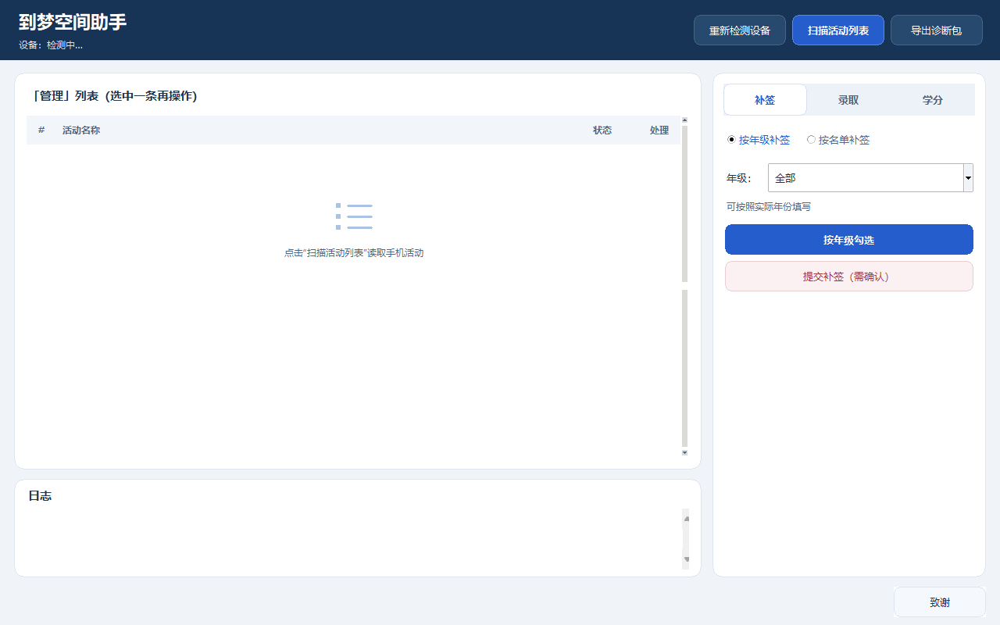

# 到梦空间助手

在 Windows 电脑上，通过 USB 连接 Android 手机，辅助处理到梦空间活动的补签、录取和学分发放。

[下载 Windows 版](https://github.com/2286057864a-web/daomeng-assistant/releases/latest) · [使用说明](docs/使用说明.md) · [源码运行与打包](docs/开发说明.md) · [更新记录](CHANGELOG.md)



## 功能

- **活动扫描**：读取需要处理的活动，到第一个已完结活动停止；当前选中活动以深蓝色突出显示。
- **补签**：按年级勾选，或导入 Excel 名单处理；年级支持手动填写。
- **录取**：按 Excel 名单演练或正式录取，支持仅有姓名的名单。
- **学分**：支持按年级勾选、按名单演练和正式发放；名单支持仅有姓名。
- **搜索**：沿用姓氏分组搜索，在结果中核对完整姓名及可用学号；保留手机当前输入法。
- **工作结果**：任务结束后可导出 Excel，保留任务汇总，按颜色列出异常和未执行人员。
- **连续任务**：同一窗口可继续处理下一项任务。
- **诊断与反馈**：导出诊断包用于排查问题。

界面使用 Python 标准库 tkinter/ttk，字体使用系统的微软雅黑 UI。当前显示“补签、录取、学分”三个页签；本地比对实现保留在源码中，默认隐藏。示意图可能与当前版本的局部细节不同。

## 下载使用

1. 从 [Releases](https://github.com/2286057864a-web/daomeng-assistant/releases/latest) 下载 Windows 程序压缩包。
2. **完整解压**后打开“到梦空间助手.exe”，保留同目录的 `_internal` 文件夹。
3. 手机开启 USB 调试及模拟点击权限，连接电脑并确认授权；登录到梦空间中具备对应活动管理权限的账号。
4. 点击“扫描活动列表”，选择活动，再执行对应操作。

按年级操作完成后，请在手机上核对并提交。按名单正式任务在电脑确认后会自动处理和提交；请先核对活动、人员及分值。不同任务的提交方式见[使用说明](docs/使用说明.md)。

## 源码快速启动

使用 Windows 和 Python 3.13。先从 [Android 官方](https://developer.android.com/tools/releases/platform-tools)下载 Windows Platform Tools，将 `platform-tools` 文件夹放在项目根目录。

```powershell
python -m venv .venv
.\.venv\Scripts\python.exe -m pip install -r requirements.txt
.\.venv\Scripts\python.exe gui.py
```

离线回归检查：

```powershell
.\.venv\Scripts\python.exe -B -m unittest discover -s tests
```

这些测试使用假设备和临时文件，不执行手机端提交。源码回归通过不等于任意手机或平台版本都已通过真机验收。

## 致谢与项目来源

感谢原项目作者与贡献者的分享，让实用的想法得以延续。

参考项目：[tangent2pi/daomeng](https://github.com/tangent2pi/daomeng)。本仓库发布的是当前 tkinter 桌面助手，与该参考项目及已有 fork 分开维护。

感谢南华大学易班工作站技术部、行政部，以及资环安团委在团学工作中的付出。也感谢每一位为团学工作付出时间与心力的同学。

第三方组件及图标说明见 [NOTICE.md](NOTICE.md)。
